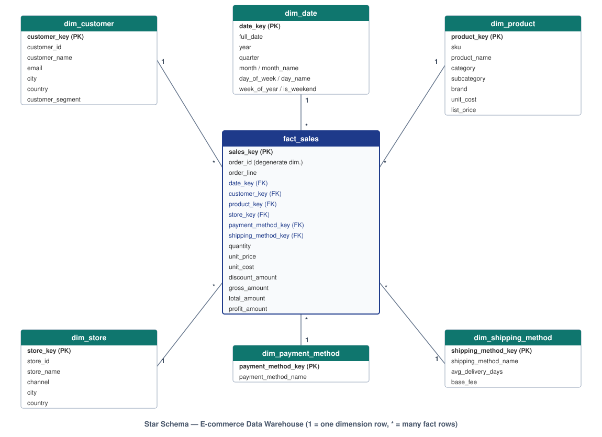
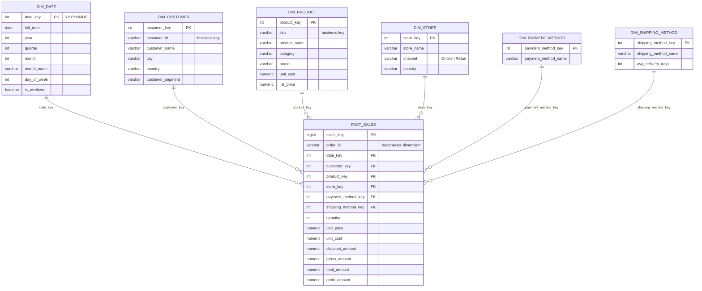

# E-commerce Data Warehouse & BI Analytics

A complete **dimensional data warehouse** for a simulated international
e-commerce business, built with **PostgreSQL** and a classic **Star Schema** —
plus a suite of **advanced analytical SQL queries** that answer real business
questions: revenue growth, customer lifetime value, category performance,
discount effectiveness and monthly KPIs.

> 🎓 **Personal / academic portfolio project.** All data is mock data
> generated by a reproducible SQL script — no real company data is used.

---

## 📌 Project Overview

Operational e-commerce databases are built for fast transactions, not for
questions like *"How did revenue grow month over month in every market?"*.
This project restructures sales data the way real analytics teams do:

- **Star Schema** (Kimball-style dimensional model): one central fact table
  at order-line grain, six dimension tables around it.
- **Analytical SQL layer**: seven documented queries using CTEs, window
  functions (`LAG`, `RANK`, `DENSE_RANK`), and `GROUPING SETS`.
- **BI-ready design**: the model plugs directly into Power BI or Tableau.

### Business questions answered

| # | Question | Query |
|---|----------|-------|
| A | Is revenue growing month over month, and by how much? | [01_monthly_sales_growth.sql](queries/01_monthly_sales_growth.sql) |
| B | Who are our highest-value customers? | [02_customer_lifetime_value.sql](queries/02_customer_lifetime_value.sql) |
| C | Which categories drive revenue and profit? | [03_category_performance.sql](queries/03_category_performance.sql) |
| D | Which products are the bestsellers? | [04_top_products.sql](queries/04_top_products.sql) |
| E | Which countries/cities generate the most revenue? | [05_sales_by_location.sql](queries/05_sales_by_location.sql) |
| F | Do discounts pay off, or do they just burn margin? | [06_discount_impact.sql](queries/06_discount_impact.sql) |
| G | How does the business perform on all core KPIs monthly? | [07_monthly_kpi_report.sql](queries/07_monthly_kpi_report.sql) |

---

## 🎯 Objectives

- Design a professional star schema for e-commerce sales analytics
- Implement it with clean DDL: surrogate keys, constraints, indexes
- Generate realistic, reproducible mock data (seasonality, discounts, skew)
- Write advanced analytical SQL that answers concrete business questions
- Document every analysis as a *business question → insight → decision*
- Deliver a portfolio-quality, fully reproducible GitHub project

---

## 🛠 Tools & Technologies

| Tool | Purpose |
|------|---------|
| **PostgreSQL 13+** | Primary database engine (free, cross-platform, strong analytical SQL) |
| **SQL Server 2019+** | Fully supported alternative — see [schema/create_tables_sqlserver.sql](schema/create_tables_sqlserver.sql) |
| **Oracle 12cR2+** | Fully supported alternative (schema + data + all queries) — see [oracle_sql_developer/](oracle_sql_developer/) |
| **SQL** | DDL, data generation, window functions, CTEs, GROUPING SETS |
| **dbdiagram.io / Mermaid** | ERD diagrams ([diagrams/](diagrams/)) |
| **Power BI / Tableau** | Optional dashboard extension (documented, not required) |

**Why PostgreSQL?** Free and open source, runs on macOS/Linux/Windows (and
Docker), has first-class analytical SQL, and lets anyone reviewing this repo
reproduce the project in minutes. The full comparison with SQL Server — and
the exact syntax differences — is in
[docs/project_report.md](docs/project_report.md#2-technology-choice-postgresql-recommended-vs-sql-server).

---

## ⭐ Star Schema Design



**Grain:** one row in `fact_sales` = one product line within one order.

- `fact_sales` holds only **foreign keys + numeric measures** (quantity,
  gross/net revenue, discount, profit). `order_id` is kept as a *degenerate
  dimension* so order-level KPIs (e.g. Average Order Value) are possible.
- Each dimension answers one analytical question: **who** (`dim_customer`),
  **what** (`dim_product`), **when** (`dim_date`), **where** (`dim_store`),
  **how paid** (`dim_payment_method`), **how shipped** (`dim_shipping_method`).
- Dimensions use integer **surrogate keys**; business keys (`customer_id`,
  `sku`) are kept as attributes.
- `unit_cost` is snapshotted into the fact row at load time so historical
  profit stays correct if product costs change later.



### Database tables

| Table | Type | Rows (sample data) | Description |
|-------|------|--------------------|-------------|
| `fact_sales` | Fact | ~5,000 | Order lines: FK's + measures (revenue, discount, profit) |
| `dim_date` | Dimension | 730 | Calendar 2025–2026, pre-computed time attributes |
| `dim_customer` | Dimension | 20 | Customers across 18 countries, 3 segments |
| `dim_product` | Dimension | 20 | Products in 5 categories with cost & list price |
| `dim_store` | Dimension | 4 | Online channel + 3 retail stores |
| `dim_payment_method` | Dimension | 5 | Credit card, PayPal, COD, … |
| `dim_shipping_method` | Dimension | 4 | Standard, Express, Same-Day, Pickup |

---

## 🚀 How to Run

### Option 1 — Local PostgreSQL

```bash
# 1. Create the database
createdb ecommerce_dw

# 2. Create the star schema
psql -d ecommerce_dw -f schema/create_tables.sql

# 3. Load the mock data (~5,000 sales, reproducible via setseed)
psql -d ecommerce_dw -f data/sample_data.sql

# 4. Run any analysis
psql -d ecommerce_dw -f queries/01_monthly_sales_growth.sql
psql -d ecommerce_dw -f queries/07_monthly_kpi_report.sql
```

### Option 2 — Docker (no local install needed)

```bash
docker run --name ecommerce-dw -e POSTGRES_PASSWORD=postgres -p 5432:5432 -d postgres:16
docker exec -i ecommerce-dw psql -U postgres -c "CREATE DATABASE ecommerce_dw;"
docker exec -i ecommerce-dw psql -U postgres -d ecommerce_dw < schema/create_tables.sql
docker exec -i ecommerce-dw psql -U postgres -d ecommerce_dw < data/sample_data.sql
docker exec -i ecommerce-dw psql -U postgres -d ecommerce_dw < queries/07_monthly_kpi_report.sql
```

### Option 3 — SQL Server

Run `schema/create_tables_sqlserver.sql`, then adapt the data script and
queries with the (small) syntax differences listed in
[docs/project_report.md](docs/project_report.md).

### Option 4 — Oracle (SQL Developer)

A complete Oracle port — schema, PL/SQL data generator and all seven
queries — lives in [oracle_sql_developer/](oracle_sql_developer/).
In SQL Developer, **Run Script (F5)**:

1. `oracle_sql_developer/schema/create_tables_oracle.sql`
2. `oracle_sql_developer/data/sample_data_oracle.sql`
3. any file in `oracle_sql_developer/queries/`

Full instructions and the PostgreSQL→Oracle syntax mapping:
[oracle_sql_developer/README.md](oracle_sql_developer/README.md).

---

## 📊 Example Query Output

*Actual output from the included dataset (PostgreSQL 16, seed 0.42;
reproducible exactly on PostgreSQL 15+).*

**Query A — Month-over-Month Sales Growth**

| year | month | month_name | total_revenue | previous_month_revenue | mom_growth_pct |
|------|-------|------------|---------------|------------------------|----------------|
| 2025 | 1 | January  | 253,895.74 | *NULL* | *NULL* |
| 2025 | 2 | February | 199,629.24 | 253,895.74 | -21.37 |
| … | | | | | |
| 2025 | 11 | November | 459,482.54 | 240,453.10 | +91.09 |
| 2025 | 12 | December | 440,277.54 | 459,482.54 | -4.18 |

**Query G — Monthly KPI Report**

| year | month | total_revenue | total_orders | avg_order_value | units_sold | active_customers | profit_margin_pct |
|------|-------|---------------|--------------|-----------------|------------|------------------|-------------------|
| 2025 | 1 | 253,895.74 | 188 | 1,350.51 | 719 | 20 | 32.77 |
| 2025 | 11 | 459,482.54 | 334 | 1,375.70 | 1,415 | 20 | 33.50 |

**Query C — Category Performance**

| category | units_sold | net_revenue | profit_margin_pct | revenue_share_pct |
|----------|------------|-------------|-------------------|-------------------|
| Electronics | 5,832 | 2,968,955.47 | 30.13 | 85.27 |
| Home & Kitchen | 1,619 | 276,552.07 | 46.05 | 7.94 |
| Fashion | 1,416 | 110,457.53 | 62.04 | 3.17 |
| Sports & Outdoors | 964 | 84,212.33 | 57.31 | 2.42 |
| Beauty & Health | 757 | 41,729.30 | 61.53 | 1.20 |

The mock data is generated with a fixed random seed (`setseed(0.42)`), so
runs are **fully reproducible on PostgreSQL 15+** (PostgreSQL 15 changed the
`random()` algorithm, so 13/14 produce a different — but statistically
identical — dataset). Every dataset shows the same patterns: a visible
Nov–Dec holiday revenue peak and skewed bestseller/top-customer
distributions.

---

## 💡 Business Insights the Project Generates

- **Seasonality:** revenue peaks in November–December (holiday season boost
  built into the data generator) — visible in Queries A and G.
- **Customer concentration:** a small group of "heavy buyer" customers
  contributes a disproportionate share of lifetime value (Query B).
- **Category economics:** Electronics drives the most revenue, while margin
  percentages differ sharply across categories (Query C).
- **Discount economics:** high-discount order lines show visibly lower
  profit margins — quantifying what promotions actually cost (Query F).

Full business interpretation of every query:
[docs/project_report.md](docs/project_report.md#4-business-intelligence-explanation-of-each-query).

---

## 📁 Folder Structure

```text
Ecommerce-Data-Warehouse-BI/
│
├── README.md                          ← you are here
│
├── schema/
│   ├── create_tables.sql              ← star schema DDL (PostgreSQL)
│   └── create_tables_sqlserver.sql    ← same schema in T-SQL
│
├── data/
│   └── sample_data.sql                ← dimensions + reproducible fact generator
│
├── queries/
│   ├── 01_monthly_sales_growth.sql    ← MoM growth (CTE + LAG)
│   ├── 02_customer_lifetime_value.sql ← CLV ranking (DENSE_RANK)
│   ├── 03_category_performance.sql    ← category revenue/profit/share
│   ├── 04_top_products.sql            ← top-10 products (RANK)
│   ├── 05_sales_by_location.sql       ← geo analysis (GROUPING SETS)
│   ├── 06_discount_impact.sql         ← discount-band margin analysis
│   └── 07_monthly_kpi_report.sql      ← consolidated monthly KPIs
│
├── oracle_sql_developer/              ← complete Oracle port (optional)
│   ├── README.md                      ← run order for SQL Developer
│   ├── schema/create_tables_oracle.sql
│   ├── data/sample_data_oracle.sql    ← PL/SQL data generator
│   └── queries/                       ← the same 7 analyses in Oracle SQL
│
├── diagrams/
│   ├── star_schema_erd.svg            ← ERD (rendered above)
│   └── star_schema.dbml               ← dbdiagram.io source (export PNG here)
│
└── docs/
    └── project_report.md              ← full BI report & design rationale
```

---

## 🧠 Skills Demonstrated

- **Data warehouse design** — dimensional modeling, grain definition,
  surrogate keys, degenerate dimensions, fact/dimension separation
- **Analytical database modeling** — star schema, date dimension with smart
  keys, cost snapshotting for historically correct profit
- **Advanced SQL** — CTEs, window functions (`LAG`, `RANK`, `DENSE_RANK`,
  window aggregates), `GROUPING SETS`, constraint design, indexing
- **KPI analysis & BI thinking** — MoM growth, CLV, AOV, margin analysis,
  each tied to a business decision
- **Data engineering fundamentals** — reproducible mock-data generation with
  seasonality and realistic statistical skew
- **Documentation** — ERD, design rationale, business-focused reporting

---

## 🔮 Future Improvements

- **SCD Type 2** on `dim_customer` to track segment/address history
- **Inventory snapshot fact table** (`fact_inventory`) for stock analytics
- **ETL pipeline** (Python or dbt) loading from CSV/API sources instead of
  a SQL generator
- **Power BI / Tableau dashboard** with KPI cards, trend lines, maps and
  customer segmentation visuals — the model is already dashboard-ready
  (see [docs/project_report.md](docs/project_report.md#6-optional-extension-power-bi--tableau-dashboard))
- **Data quality tests** (e.g. dbt tests or pgTAP) on keys and measures

---

## 📄 License & Attribution

Personal portfolio project. Mock data only — generated by
[data/sample_data.sql](data/sample_data.sql); any resemblance to real
persons or companies is coincidental.
